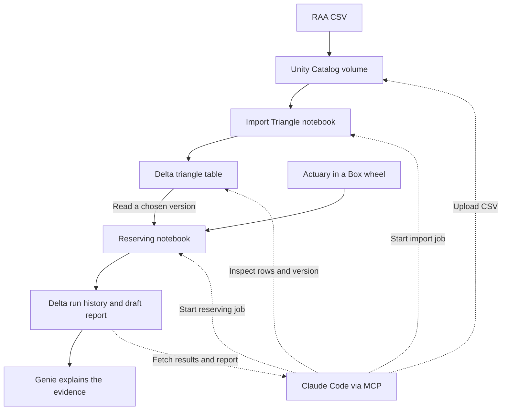

# Actuary in Databricks

The demo starts with a public RAA claims triangle. You can upload it and run
the notebooks from Databricks, then repeat those steps from an MCP client.



## Install with an agent

Use the `databricks-integration` checkout with Claude Code, the Databricks
CLI (1.3 or later), uv and Python 3.11 or later. Sign in from the checkout
using the workspace URL and start Claude Code there:

```bash
databricks auth login --host https://YOUR-WORKSPACE --profile ipc-demo
claude
```

Ask **“Install Actuary in Databricks using my ipc-demo profile.”** Claude Code
loads the [project skill](../.claude/skills/install-databricks-reserving/SKILL.md).
When there is more than one suitable Unity Catalog catalog or SQL warehouse,
specify the one you want Claude to use. The workspace access must allow
creating a schema in that catalog, running jobs, and using the warehouse.

The agent uses the signed-in CLI to deploy and the bundled MCP tools to run
the demo. Expect **55 RAA observations**, **52,135.23 IBNR**, a **26,909.01 Mack
standard error**, and a draft report linked to the selected Delta version.
The official Genie One plugin is optional for analytics.

For Codex, install the [portable skill](../skills/install-databricks-reserving/SKILL.md)
from the same checkout:

```bash
gh skill install . install-databricks-reserving --from-local --agent codex --scope project
```

You can also run the installer yourself. Use the same profile, catalog,
and optional `--schema` argument for each action. Deployment creates a
dedicated schema, managed volume, two serverless jobs and their notebooks.

```bash
uv run --no-project --python '>=3.11' --with mcp==1.28.1 python scripts/install_databricks_demo.py deploy --profile ipc-demo --catalog YOUR_CATALOG
uv run --no-project --python '>=3.11' --with mcp==1.28.1 python scripts/install_databricks_demo.py rehearse --profile ipc-demo --catalog YOUR_CATALOG
```

For a manual replay after deployment, open the returned Lakeflow job links
and use **Run now with different parameters**. Upload `raa.csv` to the
volume first or pass the CSV filename returned by the rehearsal.
The reserving job already
has its wheel dependency. For a direct interactive run from the notebook,
attach the wheel in the notebook's Environment pane as described below.

Use the `connect` action to generate registration commands for Claude Code
and Codex. Use the `genie` action after a rehearsal to create a Genie agent
on the saved results, when available. In a workspace with multiple SQL
warehouses, pass `--warehouse-id` for the one you want to use.

## Run in Databricks

For a staged demo, tell Claude Code to deploy and **import the public RAA
triangle only**. The installer action `import` returns a Catalog Explorer
link, a preview, the Delta version, and both job links. Open the table link
and select **Sample Data** to see the current rows. Open the import run
output to see the preview for the exact Delta version that was imported.

Open the **Run reserving** job and choose **Run now with different
parameters**. Set `source_version` to the imported version and keep
`method=mack`. Open the completed run and select the **reserving** notebook
task to see the draft report in Databricks. Keep the job run ID for both
follow-up questions.

Run the installer's `genie` action once after Mack completes and open the
returned Genie link. Use `connect` to register the reserving MCP server
with Claude Code, then open a session that loads it.

- In **Genie**, ask which origin year and development period had a negative
  incremental for that Mack job run, and by how much. Ask for the attempt ID.
- In **Claude Code**, ask for the saved IBNR and Mack standard error for the
  same job run ID. Ask which diagnostic put it into actuarial review and for
  the Databricks run link.

The steps below also support a manual upload and notebook run.

1. Unzip the demo package. In **Workspace**, import `Import_Triangle.py` and
   `Reserving_Demo.py` and upload the `.post2` wheel. Set both notebooks to
   **Serverless**. In the **Reserving_Demo** Environment pane, add the wheel
   by its full `/Workspace/…/actuarial_agent_harness-0.2.9.post2-py3-none-any.whl`
   path. Remove any older harness wheel before clicking **Apply**.
2. In **Catalog**, open a writable catalog and schema and create a managed
   volume called `reserving_demo_files`. Upload the supplied `raa.csv` using
   **Add data → Upload files to a volume**. Show the file in the volume.
3. In **Import_Triangle**, run the widget cell, enter that catalog and
   schema, then click **Run all**. This creates or updates
   `ipc_reserving_demo_triangles` and prints its Delta version. Open the
   table in **Catalog → Sample data**, filter to `raa`, and show the 55
   observations. Use a new demo schema for a first import on camera.
4. In **Reserving_Demo**, use the same catalog and schema. Select `raa` and
   `mack`, enter the printed Delta version, and click **Run all**. Show
   **52,135.23 IBNR**, **26,909.01 Mack standard error**, and the draft HTML
   report. In Catalog, open `ipc_reserving_demo_run_history`. Its new row
   records the input table and version, input hash, model outputs, checks,
   and report HTML. The report shown by the notebook is read back from that row.

Set both notebooks' widget behaviour to **Do Nothing** when changing
parameters for the recording. A subsequent import replaces the RAA rows in
one Delta transaction. It can create a new table version even for the same
CSV. Earlier run records retain the version and exact CSV they used.

## Ask Genie in Databricks

In the SQL editor, select the demo catalog and schema and execute:

```sql
CREATE OR REPLACE VIEW ipc_raa_reserving_review AS
SELECT attempt_id, started_at, job_run_id, method, status, source_version,
       ibnr, mack_se,
       get_json_object(artifacts['validation/validation.json'], '$.checks')
         AS validation_checks,
       get_json_object(artifacts['model/diagnostics.json'], '$.tests')
         AS diagnostic_tests
FROM ipc_reserving_demo_run_history
WHERE dataset = 'raa' AND status IN ('review_required', 'draft_ready');
```

In **Genie Agents → New**, select the view. Ask “What did the latest RAA
Mack run estimate, what triggered review, and which Delta input version
and attempt ID support your answer?”

## Repeat the demo from Claude Code over MCP

Install the [Databricks CLI](https://docs.databricks.com/aws/en/dev-tools/cli/install)
and use your browser sign-in:

```bash
databricks auth login --host https://YOUR-WORKSPACE --profile ipc-demo
```

Create two Lakeflow jobs, each with a single **Serverless Notebook** task:

| Job | Notebook | Job parameters and defaults |
|---|---|---|
| Import RAA | `Import_Triangle` | `catalog` and `schema` from the demo, `volume=reserving_demo_files`, `file_name=raa.csv` |
| Run reserving | `Reserving_Demo` | Same `catalog` and `schema`, `dataset=raa`, `method=mack`, `source_version` blank |

On each **task**, set the parameter `job_run_id` to `{{job.run_id}}`.
Keep a single concurrent run per job. Copy the two job IDs and the SQL
warehouse ID from **SQL Warehouses → Connection details**. The CLI profile
needs permission to use that warehouse and volume, run the jobs, and read
the Delta tables. The job identities need the corresponding access to the
volume and tables.

From the unzipped demo folder, add the server to Claude Code with uv:

```bash
claude mcp add --scope local ipc-reserving -- uv run --no-project --with mcp==1.28.1 \
  python "$PWD/reserving_mcp.py" --profile ipc-demo \
  --import-job-id IMPORT_JOB_ID --job-id RESERVING_JOB_ID \
  --warehouse-id WAREHOUSE_ID --catalog YOUR_CATALOG --schema YOUR_SCHEMA \
  --volume reserving_demo_files --workbench-runs "$PWD/databricks-workbench-runs"
```

1. “Upload the supplied RAA CSV and start the import. Show the Delta
   version, the row count and the first five rows once it finishes.”
2. “Run Mack on exactly that Delta version. When Lakeflow finishes, show
   the IBNR, Mack standard error, attempt ID and Databricks run link.”
3. “Fetch the draft report and prepare the saved run for my workbench.”
   Open the returned HTML path or the run link. The report is retrieved
   from the saved Delta evidence.

To show human review on the restored run, launch:

```bash
uv run --no-project --with ./actuarial_agent_harness-0.2.9.post2-py3-none-any.whl \
  reserve dashboard --out databricks-workbench-runs --host 127.0.0.1 --port 8000
```

Open <http://127.0.0.1:8000/workbench-v2/>. For an interactive factor
preview, repeat the reserving run with Basic Chain Ladder and open that
run in the dashboard. The workbench records its decisions locally. The
MCP review step copies the public RAA input and evidence locally by request.
